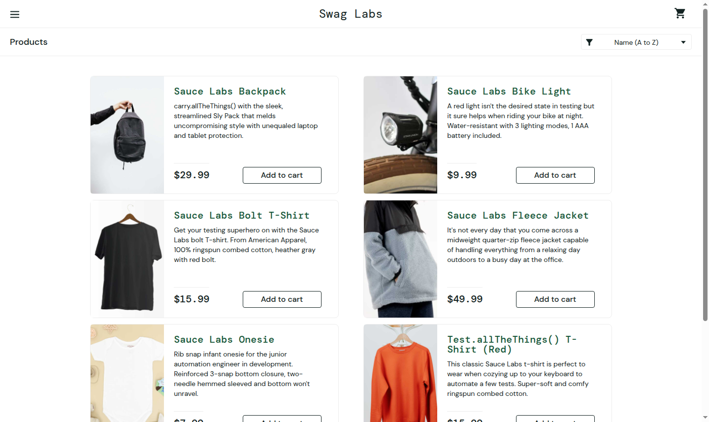
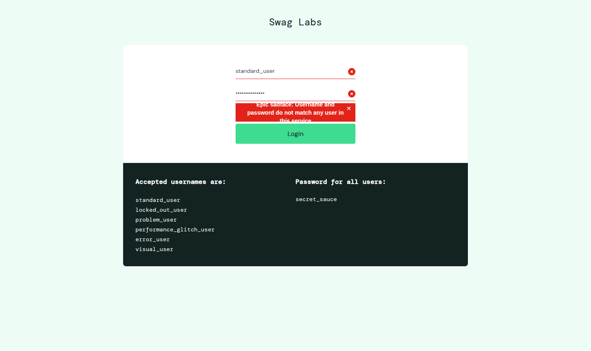
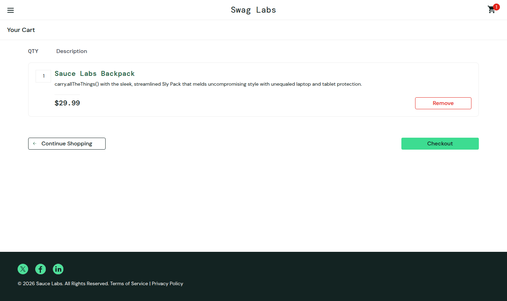
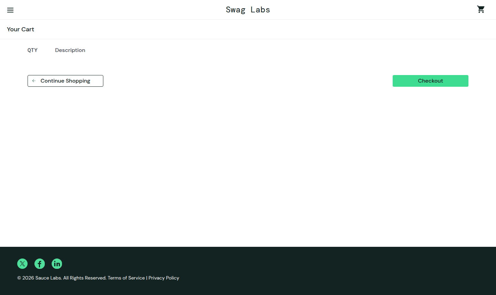
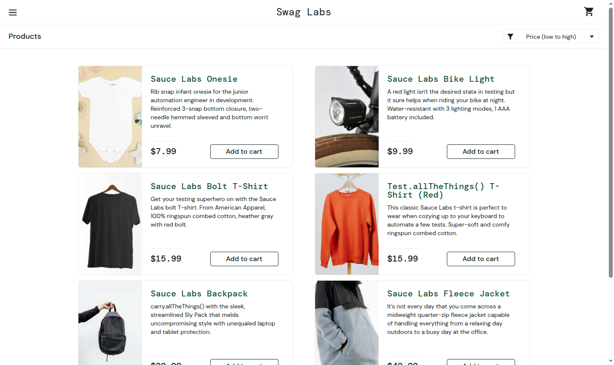
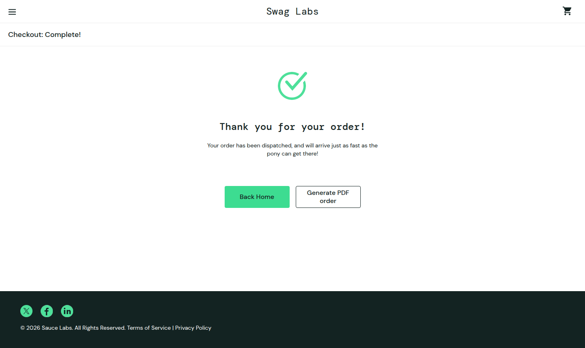
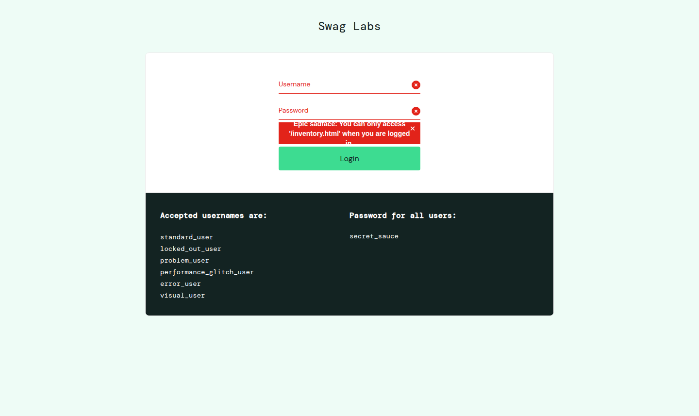

# Thực hành kiểm thử tự động website bằng Selenium

## 1. Mục tiêu và đối tượng kiểm thử

Xây dựng và thực thi **08 test case tự động** trên website bán hàng demo **[SauceDemo – Swag Labs](https://www.saucedemo.com/)** bằng Selenium WebDriver và Python. Bài thực hành kiểm tra chức năng đăng nhập, giỏ hàng, sắp xếp sản phẩm, đặt hàng và đăng xuất, đáp ứng yêu cầu tối thiểu 05 test case.

**Repo nộp bài:** https://github.com/nhung220/selenium

SauceDemo cung cấp tài khoản thực hành công khai. Các thao tác đặt hàng trong bài chỉ diễn ra trên website demo. Website không có chức năng tìm kiếm nên bài lựa chọn kiểm thử sắp xếp sản phẩm theo giá.

## 2. Công cụ và phương pháp

| Thành phần | Sử dụng |
| --- | --- |
| Ngôn ngữ | Python 3.12 |
| Điều khiển trình duyệt | Selenium WebDriver 4.51.0 |
| Trình duyệt | Google Chrome, mặc định headless |
| Tổ chức và thực thi | pytest 9.1.1 |
| Báo cáo | pytest-html 4.2.0, JUnit XML, JSON và ảnh PNG |
| Chạy trên GitHub | GitHub Actions |
| Thiết kế | Page Object Model; mỗi test dùng phiên Chrome riêng |

Kiểm thử hộp đen ở mức giao diện, gồm trường hợp hợp lệ và không hợp lệ. Các thao tác sử dụng locator `data-test`/`id`, chờ tường minh `WebDriverWait` và `expected_conditions`; không sử dụng `time.sleep()` để đồng bộ. Mỗi ca có `assert` kiểm tra kết quả thực tế, không chỉ thao tác nhấn nút. Trình duyệt được đóng bằng `finally` kể cả khi test thất bại.

## 3. Điều kiện và dữ liệu kiểm thử

- Máy đã cài Python 3.12 và Chrome, có kết nối Internet đến SauceDemo.
- Trước mỗi test, mở một phiên Chrome mới tại `https://www.saucedemo.com/`. TC04–TC08 tự đăng nhập bằng fixture `logged_in`; không phụ thuộc TC01 hoặc thứ tự chạy.
- Selenium Manager tự tìm/tải ChromeDriver tương thích khi chưa chỉ định driver thủ công.

| Dữ liệu | Giá trị |
| --- | --- |
| Tài khoản hợp lệ | `standard_user` |
| Mật khẩu hợp lệ | `secret_sauce` |
| Mật khẩu sai | `wrong_password` |
| Tài khoản bị khóa | `locked_out_user` |
| Sản phẩm | `Sauce Labs Backpack`, giá `$29.99` |
| Thông tin đặt hàng demo | First name: `Test`; Last name: `Student`; Postal code: `100000` |

Các thông tin đăng nhập trên là dữ liệu demo công khai, không phải tài khoản cá nhân.

## 4. Danh sách test case

| Mã | Chức năng / loại | Tiền điều kiện | Các bước thực hiện | Kết quả mong đợi / assertion |
| --- | --- | --- | --- | --- |
| TC01 | Đăng nhập thành công / hợp lệ | Đang ở trang đăng nhập | 1. Nhập `standard_user`.<br>2. Nhập `secret_sauce`.<br>3. Nhấn Login. | URL chứa `/inventory.html`; tiêu đề `Products`; danh sách có 6 sản phẩm. |
| TC02 | Đăng nhập sai mật khẩu / không hợp lệ | Đang ở trang đăng nhập | 1. Nhập `standard_user`.<br>2. Nhập `wrong_password`.<br>3. Nhấn Login. | Hiển thị chính xác `Epic sadface: Username and password do not match any user in this service`; nút Login vẫn xuất hiện; không vào trang sản phẩm. |
| TC03 | Tài khoản bị khóa / không hợp lệ | Đang ở trang đăng nhập | 1. Nhập `locked_out_user`.<br>2. Nhập `secret_sauce`.<br>3. Nhấn Login. | Hiển thị chính xác `Epic sadface: Sorry, this user has been locked out.`; nút Login vẫn xuất hiện; không vào trang sản phẩm. |
| TC04 | Thêm sản phẩm vào giỏ / hợp lệ | Đã đăng nhập, giỏ trống | 1. Thêm Sauce Labs Backpack.<br>2. Kiểm tra badge.<br>3. Mở giỏ hàng. | Badge bằng `1`; giỏ có đúng 1 dòng, đúng tên sản phẩm, số lượng `1`, giá `$29.99`. |
| TC05 | Xóa sản phẩm khỏi giỏ / hợp lệ | Đã đăng nhập, giỏ trống | 1. Thêm Backpack.<br>2. Mở giỏ.<br>3. Nhấn Remove. | Không còn dòng sản phẩm trong giỏ; badge số lượng biến mất. |
| TC06 | Sắp xếp giá tăng dần / hợp lệ | Đã đăng nhập tại trang sản phẩm | 1. Chọn Price (low to high).<br>2. Đọc toàn bộ 6 giá.<br>3. So sánh thứ tự giá. | Bộ lọc có giá trị `lohi`; đủ 6 giá và tăng dần; nhỏ nhất `$7.99`, lớn nhất `$49.99`. |
| TC07 | Hoàn tất đặt hàng / hợp lệ | Đã đăng nhập, giỏ trống | 1. Thêm Backpack và mở giỏ.<br>2. Nhấn Checkout.<br>3. Điền Test / Student / 100000.<br>4. Nhấn Continue.<br>5. Đối chiếu sản phẩm và tiền.<br>6. Nhấn Finish. | Tên và số lượng sản phẩm đúng; tiền hàng `$29.99`, thuế `$2.40`, tổng `$32.39`; chuyển đến `/checkout-complete.html`; xuất hiện `Thank you for your order!`; badge giỏ hàng biến mất. |
| TC08 | Đăng xuất và bảo vệ trang nội bộ | Đã đăng nhập | 1. Mở menu.<br>2. Nhấn Logout.<br>3. Kiểm tra trang đăng nhập.<br>4. Truy cập lại URL `/inventory.html`. | Sau Logout xuất hiện nút Login. Khi mở lại URL nội bộ, hệ thống vẫn giữ ở trang đăng nhập và báo `Epic sadface: You can only access '/inventory.html' when you are logged in.` |

Mã tự động tương ứng: [tests/test_saucedemo.py](tests/test_saucedemo.py). Thao tác giao diện dùng chung: [pages/store.py](pages/store.py).

## 5. Cấu trúc mã nguồn

| Đường dẫn | Vai trò |
| --- | --- |
| `README.md` | Báo cáo thực hành và hướng dẫn chạy |
| `requirements.txt` | Phiên bản thư viện trực tiếp |
| `pytest.ini` | Cấu hình pytest và đường dẫn báo cáo |
| `conftest.py` | Khởi tạo/đóng Chrome, fixture, chụp ảnh và ghi kết quả |
| `pages/store.py` | Page Object cho các thao tác với SauceDemo |
| `tests/test_saucedemo.py` | 08 test case và assertion |
| `.github/workflows/selenium.yml` | Chạy tự động và lưu artifact trên GitHub Actions |
| `reports/` | Báo cáo HTML/XML/JSON, log và ảnh minh chứng của lượt chạy |

## 6. Hướng dẫn cài đặt và chạy

### 6.1. Tải mã nguồn

```bash
git clone https://github.com/nhung220/selenium.git
cd selenium
python -m venv .venv
```

Kích hoạt môi trường ảo trên **Windows PowerShell**:

```powershell
.\.venv\Scripts\Activate.ps1
```

Nếu PowerShell chặn kích hoạt, có thể chạy trực tiếp mà không đổi execution policy:

```powershell
.\.venv\Scripts\python.exe -m pip install -r requirements.txt
.\.venv\Scripts\python.exe -m pytest --headed
```

Kích hoạt trên **macOS/Linux**:

```bash
source .venv/bin/activate
```

### 6.2. Cài thư viện và chạy toàn bộ 8 test

```bash
python -m pip install -r requirements.txt
python -m pytest
```

Mặc định Chrome chạy headless. Để thấy trình duyệt thực hiện các thao tác:

```bash
python -m pytest --headed
```

Chạy một test cụ thể:

```bash
python -m pytest tests/test_saucedemo.py::test_tc04_add_to_cart --headed
```

Kết quả của mỗi lần chạy ghi đè báo cáo trước. Nếu chỉ chạy 1 test, báo cáo mới chỉ có 1 test; chạy lại lệnh đầy đủ `python -m pytest` trước khi tổng hợp kết quả toàn bộ.

### 6.3. Xem kết quả

- Terminal: danh sách test và trạng thái `PASSED`, `FAILED` hoặc `ERROR`.
- Mở `reports/report.html` trên trình duyệt để xem báo cáo; ảnh được nhúng trong chi tiết từng test.
- `reports/junit.xml`: số test, thời gian chạy và thông tin lỗi theo định dạng JUnit.
- `reports/results.json`: thời điểm chạy theo giờ Việt Nam, kết quả và phiên bản Chrome/ChromeDriver.
- `reports/screenshots/`: ảnh chụp sau mỗi test, trước khi đóng Chrome.

**Cách đọc trạng thái:** TC02/TC03 vẫn là `PASSED` khi website từ chối đăng nhập đúng như mong đợi. `FAILED` là assertion không đúng hoặc không đạt điều kiện chờ; `ERROR` là lỗi chuẩn bị/thu dọn môi trường. Không tự kết luận website có lỗi khi nguyên nhân là mất mạng hoặc ChromeDriver.

### 6.4. Chạy trên GitHub Actions

Workflow tự chạy khi push lên `main` hoặc tạo pull request. Có thể mở **Actions → Selenium practice → Run workflow** để chạy thủ công. Sau khi chạy, mở job để xem log và tải artifact **selenium-reports** chứa HTML, XML, JSON và ảnh chụp.

Link theo dõi: https://github.com/nhung220/selenium/actions

## 7. Kết quả thực nghiệm

Lượt chạy thực tế ngày **21/10/2026**, từ **09:53:06 đến 09:53:32 (giờ Việt Nam)** trên GitHub Actions.

- **Kết quả: 8 PASSED / 0 FAILED / 0 ERROR / 0 SKIPPED.**
- Tổng thời gian pytest: **26,57 giây** (bao gồm khởi tạo và đóng các phiên trình duyệt).
- Môi trường: Ubuntu 24.04.5, Python 3.12.15; Chrome và ChromeDriver **155.0.8059.39**, chạy headless.
- Commit mã nguồn đã kiểm thử: [`55ed057`](https://github.com/nhung220/selenium/commit/55ed057eb86088174b5b7f8f9b77ddf65ece7561).
- [Xem lượt chạy và log gốc trên GitHub Actions](https://github.com/nhung220/selenium/actions/runs/39535457512).

### 7.1. Bảng tổng hợp

| Mã | Test case | Kết quả | Ảnh thực tế |
| --- | --- | --- | --- |
| TC01 | Đăng nhập thành công | **PASS** | [Xem ảnh](reports/screenshots/test_tc01_login_success_call.png) |
| TC02 | Đăng nhập sai mật khẩu | **PASS** | [Xem ảnh](reports/screenshots/test_tc02_wrong_password_call.png) |
| TC03 | Tài khoản bị khóa | **PASS** | [Xem ảnh](reports/screenshots/test_tc03_locked_account_call.png) |
| TC04 | Thêm sản phẩm vào giỏ | **PASS** | [Xem ảnh](reports/screenshots/test_tc04_add_to_cart_call.png) |
| TC05 | Xóa sản phẩm khỏi giỏ | **PASS** | [Xem ảnh](reports/screenshots/test_tc05_remove_from_cart_call.png) |
| TC06 | Sắp xếp giá tăng dần | **PASS** | [Xem ảnh](reports/screenshots/test_tc06_sort_price_low_to_high_call.png) |
| TC07 | Hoàn tất đặt hàng | **PASS** | [Xem ảnh](reports/screenshots/test_tc07_checkout_success_call.png) |
| TC08 | Đăng xuất và bảo vệ trang nội bộ | **PASS** | [Xem ảnh](reports/screenshots/test_tc08_logout_call.png) |

Trích nguyên văn phần kết luận từ [log thực thi](reports/run.log):

```text
============================== 8 passed in 26.57s ==============================
```

Bằng chứng được lưu trực tiếp trong repo: [JUnit XML](reports/junit.xml), [JSON kết quả và phiên bản trình duyệt](reports/results.json), [log pytest](reports/run.log), [báo cáo HTML](reports/report.html). GitHub hiển thị mã nguồn HTML; để xem giao diện báo cáo, clone repo rồi mở `reports/report.html`, hoặc tải artifact **selenium-reports** của lượt chạy phía trên và giải nén.

### 7.2. Hình ảnh minh chứng của từng test case

Các ảnh bên dưới do Selenium chụp từ trình duyệt ở cuối từng test, trước khi đóng phiên. Ảnh thể hiện trạng thái cuối; các bước trung gian và điều kiện kiểm tra nằm trong mã test. TC08 chụp sau khi thử mở lại trang nội bộ sau đăng xuất.

**Hình 7.1. TC01 – Đăng nhập thành công (PASS)**



**Hình 7.2. TC02 – Đăng nhập sai mật khẩu (PASS)**



**Hình 7.3. TC03 – Tài khoản bị khóa (PASS)**


**Hình 7.4. TC04 – Thêm sản phẩm vào giỏ (PASS)**



**Hình 7.5. TC05 – Xóa sản phẩm khỏi giỏ (PASS)**



**Hình 7.6. TC06 – Sắp xếp giá tăng dần (PASS)**



**Hình 7.7. TC07 – Hoàn tất đặt hàng (PASS)**



**Hình 7.8. TC08 – Đăng xuất và bảo vệ trang nội bộ (PASS)**



## 8. Nhận xét và giới hạn

Bộ test bao phủ 8 kịch bản giao diện, gồm đăng nhập hợp lệ, mật khẩu sai, tài khoản khóa, thêm/xóa giỏ hàng, sắp xếp, đặt hàng và đăng xuất. Mỗi test có dữ liệu riêng được thiết lập từ đầu để giảm phụ thuộc thứ tự thực thi.

Đây là kiểm thử chức năng trên Chrome desktop, chưa bao phủ mọi trình duyệt, giao diện di động, kiểm thử hiệu năng hoặc bảo mật đầy đủ. Giá sản phẩm, số sản phẩm và thông báo được kiểm tra theo dữ liệu demo; khi website đổi dữ liệu hoặc locator, cần đối chiếu rồi cập nhật test. Kết quả PASS chỉ có ý nghĩa cho các ca đã chạy tại thời điểm ghi nhận.

## 9. Tài liệu tham khảo

1. [SauceDemo – website được kiểm thử](https://www.saucedemo.com/).
2. [Selenium – Write your first script](https://www.selenium.dev/documentation/webdriver/getting_started/first_script/).
3. [Selenium – Waiting strategies](https://www.selenium.dev/documentation/webdriver/waits/).
4. [Selenium – Page Object Models](https://www.selenium.dev/documentation/test_practices/encouraged/page_object_models/).
5. [pytest – How to use fixtures](https://docs.pytest.org/en/stable/how-to/fixtures.html).
6. [pytest-html – User guide](https://pytest-html.readthedocs.io/en/latest/user_guide.html).
