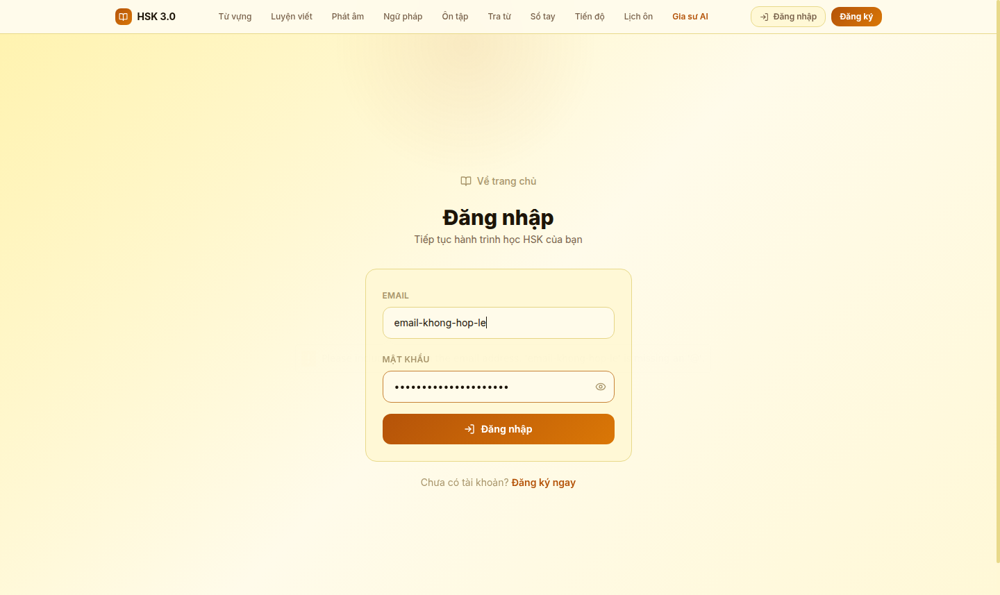
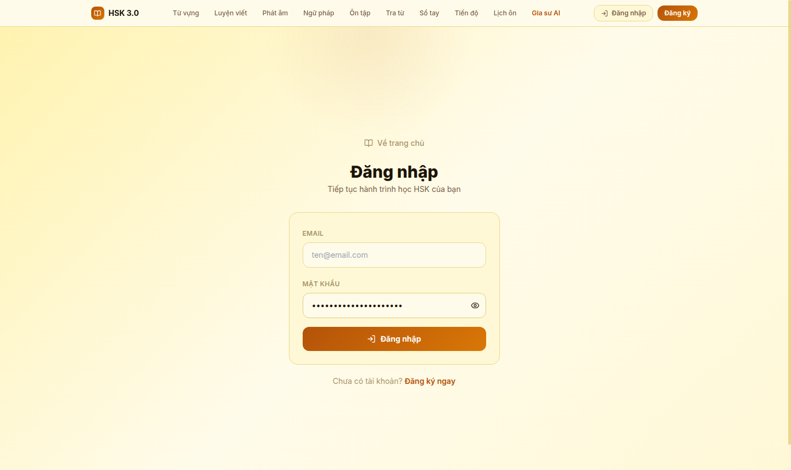
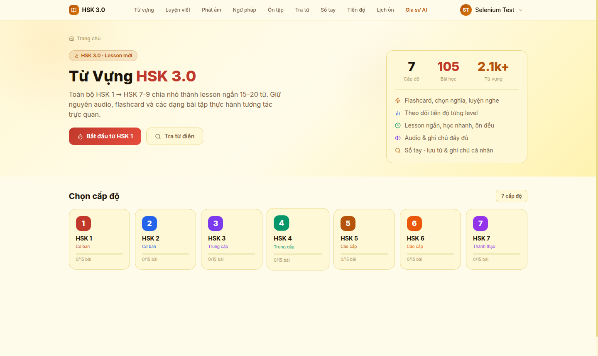
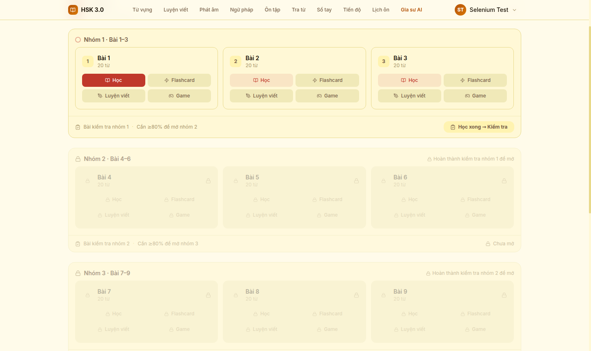
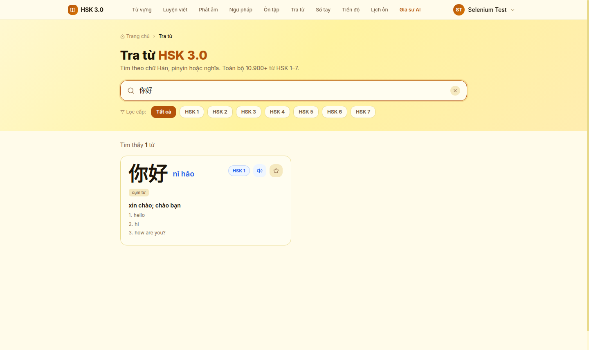
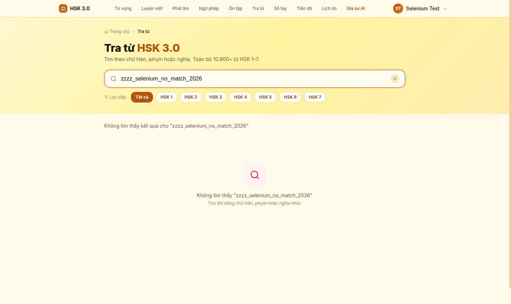
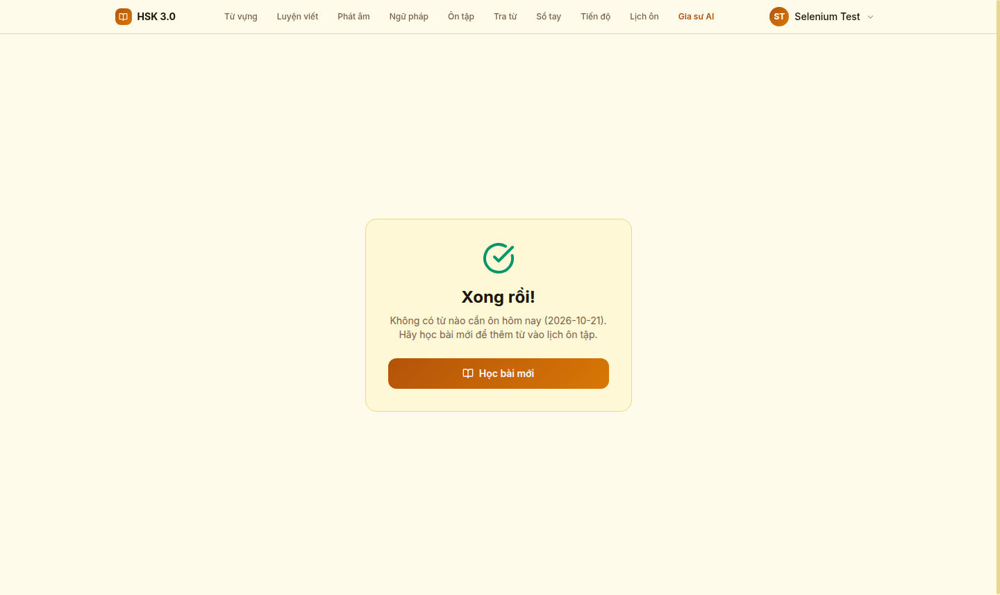

# Thực hành Selenium – Website học tiếng Trung HSK

## 1. Mục tiêu và phạm vi

Thực hiện **10 test case kiểm thử tự động** bằng Selenium WebDriver trên website **https://daln-hsk-app.vercel.app/**, đáp ứng yêu cầu tối thiểu 05 test case. Phạm vi gồm xác thực dữ liệu đăng nhập, hiện/ẩn mật khẩu, bảo vệ trang khi chưa đăng nhập, đăng nhập thành công, chọn cấp độ HSK, tra từ điển, trạng thái ôn tập và đăng xuất.

**Repo nộp bài:** https://github.com/nhung220/selenium

Các test thao tác trên website thật bằng Chrome; không thay thế API bằng mock và không chỉnh sửa mã nguồn của website. Chức năng AI, chất lượng âm thanh, nhận dạng giọng nói, toàn bộ dữ liệu từ vựng và kiểm thử hiệu năng nằm ngoài phạm vi bài này.

## 2. Công cụ và thiết kế kiểm thử

| Thành phần | Công cụ / cách áp dụng |
| --- | --- |
| Ngôn ngữ | Python 3.12 |
| Tự động hóa | Selenium WebDriver 4.51.0, Chrome và ChromeDriver |
| Framework | pytest 9.1.1 |
| Báo cáo | pytest-html 4.2.0, JUnit XML, JSON, log và ảnh PNG |
| Thiết kế | Page Object Model; Chrome mới cho từng test |
| Đồng bộ | WebDriverWait và expected_conditions; không dùng time.sleep |
| Tự động chạy | GitHub Actions; upload báo cáo kể cả khi test thất bại |

Mỗi test có assertion kiểm tra kết quả. Việc một trang mở được hoặc nút bấm được chưa đủ để kết luận chức năng đạt. Những ca từ chối đầu vào không hợp lệ vẫn PASS khi hệ thống chặn đúng như mong đợi.

## 3. Điều kiện và dữ liệu kiểm thử

- Máy cài Python 3.12 và Chrome, có Internet đến website HSK.
- Mỗi test mở trình duyệt riêng, không dùng lại phiên đăng nhập của test trước.
- Các test cần đăng nhập sử dụng một **tài khoản thử nghiệm với dữ liệu giả**. Nếu chưa cấu hình tài khoản có sẵn, fixture tự đăng ký đúng một tài khoản cho mỗi lượt pytest có test cần đăng nhập: tên `Selenium Test`, email `selenium.<uuid>@example.invalid`, mật khẩu ngẫu nhiên chỉ giữ trong bộ nhớ.
- Quá trình đăng ký thử đã được khảo sát bằng Selenium. Mật khẩu không được in vào log, lưu trong repo hoặc xuất vào JSON kết quả.
- Test chọn cấp độ và tra từ không hoàn thành bài học hay lưu tiến độ, nên tài khoản mới vẫn có trạng thái ôn tập trống.

| Dữ liệu | Giá trị / mục đích |
| --- | --- |
| Email sai định dạng | `email-khong-hop-le` – kiểm tra HTML5, không gửi tới server |
| Mật khẩu giả cho test giao diện | `SyntheticPassword123!` – không phải mật khẩu tài khoản thử nghiệm |
| Tài khoản hợp lệ | Fixture tự đăng ký bằng dữ liệu giả, hoặc đọc từ biến môi trường |
| Từ cần tra | `你好`; pinyin mong đợi `nǐ hǎo` |
| Chuỗi không tồn tại | `zzzz_selenium_no_match_2026` |
| Cấp độ | HSK 1 |

Có thể tái sử dụng một tài khoản **dành riêng cho kiểm thử và chưa có tiến độ học** bằng cách cấu hình đồng thời `HSK_TEST_EMAIL`, `HSK_TEST_PASSWORD`, và tên hiển thị `HSK_TEST_NAME`. Không dùng tài khoản cá nhân nếu dự định đưa ảnh/log lên repo công khai. Khi không cấu hình, bộ test dùng dữ liệu giả như trên. Mỗi lần chạy đầy đủ sẽ tạo một bản ghi tài khoản thử nghiệm mới trên website; mật khẩu ngẫu nhiên không được giữ lại sau lượt chạy.

## 4. Bảng đặc tả test case

| Mã | Chức năng | Tiền điều kiện | Các bước thực hiện | Kết quả mong đợi |
| --- | --- | --- | --- | --- |
| TC01 | Bắt buộc nhập email và mật khẩu | Chưa đăng nhập | 1. Mở `/login`.<br>2. Để trống hai trường.<br>3. Nhấn Đăng nhập. | Hai input có `validity.valueMissing = true`; focus ở email; vẫn ở `/login`. |
| TC02 | Email không đúng định dạng | Chưa đăng nhập | 1. Mở đăng nhập.<br>2. Nhập `email-khong-hop-le` và mật khẩu giao diện giả.<br>3. Nhấn Đăng nhập. | Email có `validity.typeMismatch = true`; focus ở email; không rời `/login`. |
| TC03 | Hiện/ẩn mật khẩu | Chưa đăng nhập | 1. Nhập chuỗi mật khẩu giao diện giả.<br>2. Nhấn biểu tượng hiện mật khẩu.<br>3. Nhấn lại để ẩn. | Loại input chuyển `password → text → password`; giá trị không bị thay đổi. |
| TC04 | Bảo vệ trang tra từ | Chrome mới, chưa đăng nhập | 1. Mở trực tiếp `/search`.<br>2. Chờ điều hướng. | Chuyển đến `/login`; xuất hiện ô email; không xuất hiện ô tra từ. |
| TC05 | Đăng nhập thành công | Tài khoản thử nghiệm đã được chuẩn bị | 1. Mở đăng nhập.<br>2. Nhập thông tin hợp lệ.<br>3. Nhấn Đăng nhập. | Vào `/vocabulary`; hiển thị tên người dùng và tiêu đề Từ Vựng HSK 3.0; không còn ô mật khẩu. |
| TC06 | Chọn HSK 1 | Đã đăng nhập | 1. Ở trang từ vựng.<br>2. Nhấn Bắt đầu từ HSK 1. | Hiển thị cấp HSK 1 và danh sách có Bài 1 với phần tử có thể mở bài. |
| TC07 | Tra từ tồn tại | Đã đăng nhập | 1. Mở Tra từ.<br>2. Nhập `你好`.<br>3. Chờ kết quả. | Hiển thị đúng chữ `你好` và pinyin `nǐ hǎo` trong kết quả; vẫn ở `/search`. |
| TC08 | Tra từ không tồn tại | Đã đăng nhập | 1. Mở Tra từ.<br>2. Nhập `zzzz_selenium_no_match_2026`.<br>3. Chờ phản hồi. | Hiển thị trạng thái không tìm thấy / 0 kết quả; ô tìm vẫn giữ nguyên chuỗi; không rời `/search`. |
| TC09 | Ôn tập khi chưa học từ | Tài khoản thử nghiệm chưa hoàn thành bài | 1. Đăng nhập.<br>2. Mở `/review`. | Có trạng thái Xong rồi!, thông báo không có từ cần ôn hôm nay, và link Học bài mới trỏ về `/vocabulary`. |
| TC10 | Đăng xuất và chặn lại trang riêng | Đã đăng nhập | 1. Mở menu tài khoản.<br>2. Nhấn Đăng xuất.<br>3. Mở lại `/search`. | Về `/login`; hiện ô email; không còn nút tài khoản đã đăng nhập. |

Test case không phụ thuộc thứ tự chạy. Fixture tạo dữ liệu tài khoản là bước thiết lập chung, không được tính thêm thành một test case trong tổng 10 ca.

## 5. Cấu trúc mã nguồn

| Đường dẫn | Vai trò |
| --- | --- |
| `tests/test_hsk.py` | 10 test case với assertion |
| `pages/hsk.py` | Các thao tác giao diện dùng chung |
| `conftest.py` | Fixture Chrome, chuẩn bị tài khoản, ảnh và JSON kết quả |
| `pytest.ini` | Cấu hình phát hiện test và báo cáo |
| `requirements.txt` | Phiên bản thư viện |
| `.github/workflows/selenium.yml` | Workflow chạy Selenium và lưu artifact |
| `reports/` | Bằng chứng của lượt chạy HSK được ghi rõ ở mục 7 |

## 6. Hướng dẫn cài đặt và chạy

### 6.1. Tải mã nguồn và tạo môi trường

```bash
git clone https://github.com/nhung220/selenium.git
cd selenium
python -m venv .venv
```

Windows PowerShell – chạy trực tiếp Python trong môi trường ảo:

```powershell
.\.venv\Scripts\python.exe -m pip install -r requirements.txt
.\.venv\Scripts\python.exe -m pytest --headed
```

macOS/Linux:

```bash
source .venv/bin/activate
python -m pip install -r requirements.txt
python -m pytest
```

Selenium Manager tự tìm/tải driver tương thích. `--headed` hiển thị cửa sổ Chrome; bỏ cờ này để chạy headless. Có thể cấu hình đường dẫn thủ công qua `CHROME_BINARY` và `CHROMEDRIVER` khi cần.

### 6.2. Chạy từng test

```bash
python -m pytest tests/test_hsk.py::test_tc07_search_existing_word --headed
```

Các test yêu cầu đăng nhập tự chuẩn bị dữ liệu bằng fixture; không cần chạy TC05 trước. Sau khi chạy lẻ, chạy lại toàn bộ `python -m pytest` để báo cáo chứa đủ 10 ca.

### 6.3. Đọc báo cáo

- Terminal: trạng thái PASSED / FAILED / ERROR và tóm tắt.
- `reports/report.html`: mở bằng trình duyệt sau khi tải/clone repo; ảnh được nhúng trong chi tiết test. GitHub chỉ hiển thị mã nguồn HTML.
- `reports/junit.xml`: số test, trạng thái và thời gian theo JUnit.
- `reports/results.json`: kết quả thực tế, thời điểm theo giờ Việt Nam, phiên bản trình duyệt/driver.
- `reports/screenshots/`: ảnh chụp cuối từng test, trước khi đóng Chrome.
- Khi test thất bại, thêm `reports/<test>_dom.json` để đối chiếu trạng thái giao diện.

Workflow chạy khi push lên `main`, tạo pull request hoặc chọn **Actions → Selenium practice → Run workflow**. Sau khi chạy, tải artifact **selenium-reports**. Workflow chỉ có quyền đọc nội dung repo.

## 7. Kết quả thực nghiệm và hình ảnh

### 7.1. Thông tin lượt chạy

Bằng chứng dưới đây được lấy từ **GitHub Actions – Selenium practice #5**, chạy trên website **https://daln-hsk-app.vercel.app/** ngày **21/10/2026**.

| Thông tin | Giá trị |
| --- | --- |
| Bắt đầu / kết thúc pytest | 10:26:41 – 10:27:29, giờ Việt Nam (UTC+7) |
| Mã nguồn được kiểm thử | `b54bd4fd1624db0ea73ffa8ddb318a8ef0c4a168` |
| Môi trường | Ubuntu, Python 3.12.15, Chrome/ChromeDriver 155.0.8059.84 |
| Tổng số test case | 10 |
| PASS / FAIL / ERROR / SKIP | **10 / 0 / 0 / 0** |
| Tỷ lệ đạt | **100% trong phạm vi 10 ca đã thực thi** |
| Thời gian pytest theo log | **48,25 giây**, bao gồm thiết lập và dọn dẹp |
| Mã thoát | 0 |

Nguồn đối chiếu: [lượt chạy Actions #5](https://github.com/nhung220/selenium/actions/runs/39538559105), [JUnit XML](reports/junit.xml), [JSON kết quả](reports/results.json) và [log thực thi](reports/run.log).

Báo cáo HTML có nhúng ảnh nằm trong artifact **selenium-reports** của lượt chạy trên. Tải và giải nén artifact, rồi mở `report.html` bằng trình duyệt. Repo lưu trực tiếp 10 ảnh PNG và các tệp kết quả để đọc ngay trên GitHub; `reports/report.html` được tạo khi chạy lại bộ test.

### 7.2. Tổng hợp kết quả từng test case

| Mã | Nội dung kiểm thử | Kết quả | Ảnh minh chứng |
| --- | --- | --- | --- |
| TC01 | Bắt buộc nhập email và mật khẩu | PASS | [Xem ảnh](reports/screenshots/test_tc01_login_required_fields_call.png) |
| TC02 | Email không đúng định dạng | PASS | [Xem ảnh](reports/screenshots/test_tc02_invalid_email_format_call.png) |
| TC03 | Hiện/ẩn mật khẩu | PASS | [Xem ảnh](reports/screenshots/test_tc03_toggle_password_visibility_call.png) |
| TC04 | Bảo vệ trang tra từ | PASS | [Xem ảnh](reports/screenshots/test_tc04_protected_search_requires_login_call.png) |
| TC05 | Đăng nhập thành công | PASS | [Xem ảnh](reports/screenshots/test_tc05_login_success_call.png) |
| TC06 | Chọn HSK 1 | PASS | [Xem ảnh](reports/screenshots/test_tc06_select_hsk1_call.png) |
| TC07 | Tra từ tồn tại | PASS | [Xem ảnh](reports/screenshots/test_tc07_search_existing_word_call.png) |
| TC08 | Tra từ không tồn tại | PASS | [Xem ảnh](reports/screenshots/test_tc08_search_no_results_call.png) |
| TC09 | Ôn tập khi chưa học từ | PASS | [Xem ảnh](reports/screenshots/test_tc09_review_empty_state_call.png) |
| TC10 | Đăng xuất và chặn lại trang riêng | PASS | [Xem ảnh](reports/screenshots/test_tc10_logout_protects_session_call.png) |

### 7.3. Ảnh minh chứng thực thi

Các ảnh là ảnh chụp cuối từng test trước khi đóng Chrome, lấy nguyên từ artifact của lượt chạy #5. Trạng thái PASS được xác nhận bằng assertion và báo cáo thực thi; một ảnh tĩnh không thể hiện toàn bộ chuỗi thao tác hoặc các thuộc tính HTML đã kiểm tra.

#### Hình 7.1. TC01 – Bắt buộc nhập email và mật khẩu


Biểu mẫu vẫn ở trang đăng nhập và focus ở ô email. Assertion xác nhận cả hai trường thiếu dữ liệu bắt buộc.

#### Hình 7.2. TC02 – Email không đúng định dạng



Ô email giữ chuỗi sai định dạng; trình duyệt chặn gửi biểu mẫu. Assertion kiểm tra `validity.typeMismatch`.

#### Hình 7.3. TC03 – Hiện/ẩn mật khẩu



Ảnh ghi nhận trạng thái cuối sau khi ẩn lại mật khẩu. Assertion đã kiểm tra chuỗi chuyển đổi `password → text → password` và giá trị không thay đổi.

#### Hình 7.4. TC04 – Bảo vệ trang tra từ


Truy cập trực tiếp `/search` khi chưa đăng nhập được chuyển về `/login`.

#### Hình 7.5. TC05 – Đăng nhập thành công



Trang từ vựng hiển thị tiêu đề Từ Vựng HSK 3.0 và tên tài khoản thử nghiệm Selenium Test sau khi đăng nhập.

#### Hình 7.6. TC06 – Chọn HSK 1



Danh sách bài học HSK 1 xuất hiện, có Bài 1 và liên kết mở bài học.

#### Hình 7.7. TC07 – Tra từ tồn tại



Kết quả tra cứu hiển thị chữ `你好` và pinyin `nǐ hǎo`.

#### Hình 7.8. TC08 – Tra từ không tồn tại



Website hiển thị không tìm thấy kết quả và giữ nguyên chuỗi tra cứu.

#### Hình 7.9. TC09 – Ôn tập khi chưa học từ



Trang ôn tập hiển thị Xong rồi!, thông báo không có từ cần ôn và nút Học bài mới.

#### Hình 7.10. TC10 – Đăng xuất và chặn lại trang riêng


Sau khi đăng xuất rồi truy cập lại `/search`, website đưa người dùng về trang đăng nhập.

## 8. Nhận xét và giới hạn

Bộ test tập trung vào luồng xác thực, tra cứu và một số trạng thái học tập. Kiểm tra HTML5 ở TC01–TC02 là kiểm tra phía trình duyệt, chưa chứng minh server có đầy đủ validation. TC03 kiểm tra hiển thị giao diện, không đánh giá toàn bộ an toàn lưu trữ mật khẩu. TC04/TC10 kiểm tra chặn truy cập giao diện, không thay thế kiểm thử phân quyền API.

Nếu dữ liệu, giao diện hoặc yêu cầu nghiệp vụ thay đổi, cần xác minh nguyên nhân trước khi sửa test. Một assertion không khớp chưa tự động chứng minh website có lỗi: có thể do kỳ vọng, locator, trạng thái dữ liệu hoặc môi trường. Kết quả chỉ áp dụng cho các ca và lượt chạy được nêu.

## 9. Tài liệu tham khảo

1. [Website HSK được kiểm thử](https://daln-hsk-app.vercel.app/).
2. [Selenium – First script](https://www.selenium.dev/documentation/webdriver/getting_started/first_script/).
3. [Selenium – Waiting strategies](https://www.selenium.dev/documentation/webdriver/waits/).
4. [Selenium – Page Object Models](https://www.selenium.dev/documentation/test_practices/encouraged/page_object_models/).
5. [pytest – Fixtures](https://docs.pytest.org/en/stable/how-to/fixtures.html).
6. [pytest-html – User guide](https://pytest-html.readthedocs.io/en/latest/user_guide.html).
